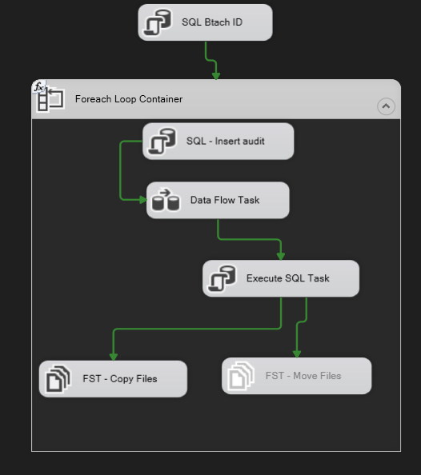
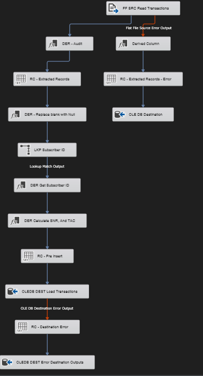

# Telecom DWH – SSIS ETL Package

An ETL solution built with **SQL Server Integration Services (SSIS)** that loads customer transaction data from CSV files into a telecom data warehouse. The source system generates a CSV file every 5 minutes; each file is validated, transformed, loaded, and then archived.

## Source File

| Column     | Type      | Length | Nullable | Sample              |
|------------|-----------|--------|----------|---------------------|
| ID         | Int       | –      | No       | 156                 |
| IMSI       | String    | 9      | No       | 310120265           |
| IMEI       | String    | 14     | Yes      | 490154203237518     |
| CELL       | Int       | –      | No       | 123                 |
| LAC        | Int       | –      | No       | 12                  |
| EVENT_TYPE | String    | 1      | Yes      | 1                   |
| EVENT_TS   | Timestamp | –      | No       | 16/1/2020 7:45:43   |

## Transformation & Validation Rules

| Source Column | Rule                                                                 | Target Column      |
|---------------|----------------------------------------------------------------------|--------------------|
| ID            | As-is                                                                | Transaction_id     |
| IMSI          | As-is; **reject** the record if null                                 | IMSI               |
| IMSI          | Lookup against the IMSI reference table; if not found, `-99999`      | subscriber_id      |
| IMEI          | First 8 characters; if null or length < 14, `-99999`                 | TAC                |
| IMEI          | Last 6 characters; if null or length < 14, `-99999`                  | SNR                |
| IMEI          | As-is                                                                | IMEI               |
| CELL          | As-is; **reject** if null                                            | CELL               |
| LAC           | As-is; **reject** if null                                            | LAC                |
| EVENT_TYPE    | As-is                                                                | EVENT_TYPE         |
| EVENT_TS      | Validate as datetime; **reject** if invalid or null                  | EVENT_TS           |

## Rejected Records

Rejected records are written to a separate error table together with the **original CSV file name**.

## Package Design

### Control Flow

1. **SQL – Batch ID**: generates a batch identifier for the run.
2. **Foreach Loop Container**: iterates over every CSV file in the input folder.
   - **SQL – Insert audit**: logs the file being processed.
   - **Data Flow Task**: loads the file (see below).
   - **Execute SQL Task**: updates the audit record after the load.
   - **FST – Copy Files**: copies the processed file to the archive folder.
   - **FST – Move Files**: moves the processed file out of the input folder.

### Data Flow

1. **FF SRC – Read Transactions**: flat file source.
   - Flat File error output → *Derived Column* → *RC – Extracted Records – Error* → *OLE DB Destination* (error table).
2. **DER – Audit**: adds file name and batch information.
3. **RC – Extracted Records**: row count of extracted records.
4. **DER – Replace blank with Null**: normalizes empty strings.
5. **LKP – Subscriber ID**: lookup on the IMSI reference table (match output continues).
6. **DER – Get Subscriber ID**: sets `-99999` when no match is found.
7. **DER – Calculate SNR and TAC**: derives TAC and SNR from IMEI.
8. **RC – Pre Insert**: row count before the insert.
9. **OLEDB DEST – Load Transactions**: loads valid rows into the target table.
   - OLE DB Destination error output → *RC – Destination Error* → *OLEDB DEST – Error Destination Outputs*.

## Technologies

- SQL Server / SSIS (Visual Studio – SSDT)
- Flat File Source, Lookup, Derived Column, Row Count, OLE DB Destination
- Foreach Loop Container, File System Task, Execute SQL Task

## How to Run

1. Open the solution in Visual Studio with SSDT installed.
2. Update the connection managers (SQL Server database and CSV input folder).
3. Set the Archive/Processed folder path in the package variables.
4. Run the package manually, or schedule it with SQL Server Agent every 5 minutes.
